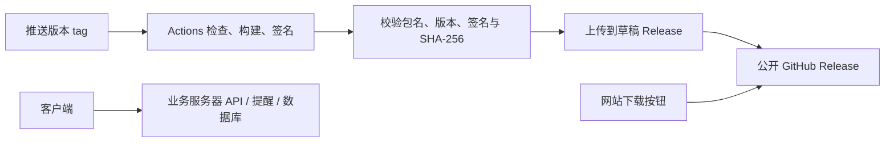

# Android 发布与下载

## 当前状态与目标

2026-11-09 将正式 Android 安装包迁往公开仓库 GitHub Releases。`v0.3.2` 是当前稳定版，约 23 MB，文件与原官网下载完全一致；`v0.3.0`、`v0.3.1` 保留历史归档。客户端没有应用内版本检查，也没有静默更新功能。

`.github/workflows/android-release.yml` 将 Android 分发从业务部署中拆出。原生产签名已配置到本仓库 Actions Secrets，后续推送版本 tag 即可触发发布。首次迁移直接上传经签名和哈希核验的现有 APK，保留原始 tag 对应的代码，不重编历史版本。



## 一次性配置

本仓库已完成以下配置。迁移到其他仓库时，在 **Settings → Secrets and variables → Actions** 中配置以下 Repository secrets，全部取自已有 `android/key.properties` 及它引用的 keystore：

| Secret | 内容 |
| --- | --- |
| `ANDROID_KEYSTORE_BASE64` | 现有 release keystore 的单行 Base64 |
| `ANDROID_KEYSTORE_PASSWORD` | 原 `storePassword` |
| `ANDROID_KEY_ALIAS` | 原 `keyAlias` |
| `ANDROID_KEY_PASSWORD` | 原 `keyPassword` |

不要重新生成签名；Android 覆盖升级需要原签名。只上传到本人管理的客户端仓库 Actions Secrets，不要写到 Git、Release、日志、Dart 编译参数或聊天中。`tool/android-signing.sha256` 保存的是可公开的生产证书指纹，流水线会比对；它不是私钥。

工作流只在版本 tag 上发布；不会向 PR 构建提供签名密钥。构建 job 只有代码读取权限，发布 job 才有 `contents: write`，使用 GitHub 自带短期 token，不需要额外长期 PAT。keystore 会在构建结束后删除。

极光开通后另设 Actions **variable** `JPUSH_APP_KEY`（AppKey 是客户端公开标识）。`JPUSH_MASTER_SECRET` 始终留在服务端。未开通时不设置 AppKey。

## 日常发版

1. 合入已验证的修改，将 `pubspec.yaml` 的版本及 build number 一起递增，例如 `0.3.3+6`。
2. 提交并推送代码，再推送匹配的 tag：

   ```sh
   git tag -a v0.3.3 -m "Release 0.3.3"
   git push origin v0.3.3
   ```

3. 在 Actions 检查结果。工作流会运行 Dart 分析、Flutter 测试、网页 JS 测试、发布校验测试，再构建签名 ARM64 APK。
4. 全部校验成功后上传草稿 Release，三个文件上传成功才公开并设为 latest：`xiabanwang-android-arm64.apk`、`SHA256SUMS`、`android-release.json`。
5. 通过匿名浏览器下载一次，并在已安装旧版的 Android 真机验证覆盖升级和账号保留。

工作流手动运行时必须选择 tag，选择 main 不会发布。失败留下的草稿可重新运行；已公开版本不可覆盖，修复必须递增版本。工作流校验包名、APK 内版本、原签名证书以及 Flutter ARM64 运行库，禁止误发 debug 签名或错误架构。

构建固定 Flutter 3.47.9、Java 17 和 Android build-tools 36.0.0，依赖遵循已提交的 `pubspec.lock`；Actions 固定提交 SHA。升级这些版本应先验证构建。

## 下载入口与兼容

网站下载按钮使用以下固定入口；首次迁移验证匿名下载及 SHA-256 匹配后再切换网站：

   <https://github.com/DengYuncheng27/bus_remind_app/releases/latest/download/xiabanwang-android-arm64.apk>

后端部署检查会拒绝指向不存在 Release 的新下载页。旧版 `/downloads/xiabanwang-0.3.0.apk`、`0.3.1.apk`、`0.3.2.apk` 由 API 返回 302，跳转至各自版本的 GitHub 原始附件；`/downloads/xiabanwang-latest.apk` 跳转至最新稳定版。旧 `.apk.sha256` 地址跳转至相应 Release 的 `SHA256SUMS`。业务服务器只返回跳转响应，不转发 APK 内容。

稳定入口不携带版本号；每次发布只是更新 GitHub 的 latest，网站不需要重新部署。`android-release.json` 记录固定版本下载地址、SHA-256、包大小、versionCode、源代码 revision 和签名指纹，可用于后续更新功能；当前 App 尚未读取它。

## 分工

- **GitHub Actions / Releases**：检查、构建、签名、版本记录和 APK 下载。APK 不进 Git 仓库，也不使用会过期的 Actions artifact URL 作为用户下载地址。
- **现有服务器**：API、SQLite、定时提醒、管理后台和现有 Web/PWA。GitHub Releases 不能运行这些服务。
- **Web/PWA**：本次保持 `bus.su7.space` 域名及 `/sw.js`，保留登录和通知订阅。静态资源可后续迁往 CDN，但应继续保持用户入口域名与同源 API 路由。
- **安装包分发**：全部使用 GitHub Releases，不再使用业务服务器或其他镜像提供 APK。GitHub 连接不畅时可先使用网页版。
- **iPhone**：现阶段使用 PWA；未来原生包走 TestFlight / App Store，不能让普通用户从 Releases 下载 IPA 后直接安装。

## ADR：将 APK 分发与业务部署分离

状态：已采纳。用户明确选择全部安装包通过 GitHub Releases 分发。

原因：现在 APK、下载页与业务发布绑定，每次修改下载版本需要重新部署，文件流量与提醒 API 争用业务主机。公开客户端仓库已经具备使用 Releases 的条件，无需新建下载服务。

取舍：GitHub Releases 有版本历史和稳定下载入口，运维成本低；国内网络可达性受 GitHub 连接状况影响。保留现有后端部署及回滚流程，Android 发版不再要求重启业务服务。

参考：[GitHub Releases](https://docs.github.com/en/repositories/releasing-projects-on-github/about-releases)、[固定下载入口](https://docs.github.com/en/repositories/releasing-projects-on-github/linking-to-releases)、[Android 应用签名](https://developer.android.com/studio/publish/app-signing)、[Flutter Android 发布](https://docs.flutter.dev/deployment/android)。
